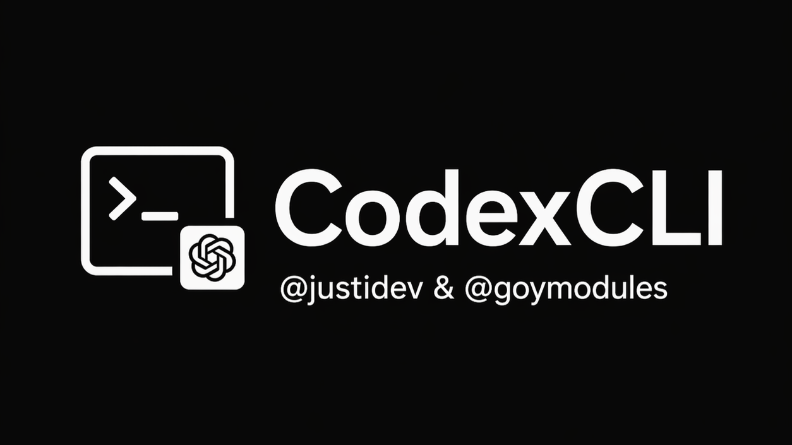

# CodexCLI — README EN

[](https://t.me/goymodules)
[](https://github.com/sepiol026-wq/GoyModules/stargazers)
[](https://github.com/sepiol026-wq/GoyModules/forks)
[](https://github.com/sepiol026-wq/GoyModules/issues)
[](https://github.com/sepiol026-wq/GoyModules/pulls)
[](https://github.com/sepiol026-wq/GoyModules/commits/main)
[](https://github.com/sepiol026-wq/GoyModules/commits/main)
[](https://github.com/sepiol026-wq/GoyModules/blob/main/LICENSE)

[Home](../README.md) · [Catalog](./readme_en.md) · [Русский](./readme_codexcli_ru.md)

## What this module is
CodexCLI is an AI module for Hikka and Heroku focused on CLI automation, practical DevOps workflows, and in-chat control directly from Telegram.

## Origin and collaboration
- The module is a **fork of QwenCLI** adapted for Codex/OpenAI flows.
- It is developed collaboratively, with fork support and maintenance noted via Telegram: **[@justidev](https://t.me/justidev)**.

## How it works
The module exposes an internal command suite, supports Codex CLI authentication, and enables AI tasks, patch workflows, and utility actions through userbot commands.

## Module file
- `heroku/CodexCLI.py` (Heroku archive)

## Installation
```text
.dlm https://raw.githubusercontent.com/sepiol026-wq/GoyModules/main/heroku/CodexCLI.py
```

## First run (important)
To install dependencies and bootstrap runtime, run:
```text
.cdxinstall
```
If you use a custom prefix, replace `.` with your own (for example `!cdxinstall`).

## Core commands
- `.cdxinstall` — install/reinstall dependencies.
- `.cdxauth` — configure Codex authentication.
- `.cdxhelp` — show the command map.
- `.cdx*` — CodexCLI command family (see in-module help for exact commands).

## Typical workflow
1. Install with `.dlm`.
2. Run `.cdxinstall`.
3. Complete auth via `.cdxauth`.
4. Review features with `.cdxhelp` and use `.cdx*` commands.

## Navigation
- [Root](../README.md)
- [Back to English index](./readme_en.md)
- [Русская версия](./readme_codexcli_ru.md)

## License
This README and module are protected under **GNU AGPLv3**. Details: [LICENSE](../LICENSE).
