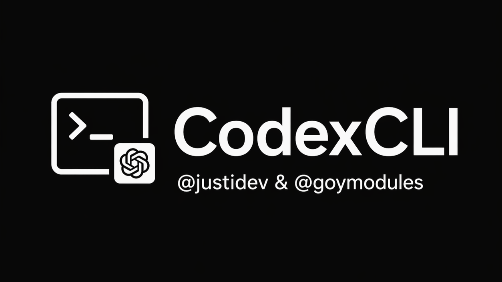

# CodexCLI — README RU

[](https://t.me/goymodules)
[](https://github.com/sepiol026-wq/GoyModules/stargazers)
[](https://github.com/sepiol026-wq/GoyModules/forks)
[](https://github.com/sepiol026-wq/GoyModules/issues)
[](https://github.com/sepiol026-wq/GoyModules/pulls)
[](https://github.com/sepiol026-wq/GoyModules/commits/main)
[](https://github.com/sepiol026-wq/GoyModules/commits/main)
[](https://github.com/sepiol026-wq/GoyModules/blob/main/LICENSE)

[Главная](../README.md) · [Каталог](./readme_ru.md) · [English](./readme_codexcli_en.md)

## Что это за модуль
CodexCLI — AI-модуль для Hikka и Heroku с упором на CLI-автоматизацию, рабочие DevOps-сценарии и удобное управление прямо из Telegram.

## Происхождение и соавторство
- Модуль является форком **QwenCLI** и адаптирован под экосистему Codex/OpenAI.
- Разработка выполнена совместно, форк поддерживается в том числе через Telegram: **[@justidev](https://t.me/justidev)**.

## Как это работает
Модуль разворачивает внутренний набор команд, поддерживает авторизацию Codex CLI и позволяет выполнять AI-задачи, патчи и вспомогательные workflow через команды юзербота.

## Файл модуля
- `heroku/CodexCLI.py` (архив Heroku)

## Установка
```text
.dlm https://raw.githubusercontent.com/sepiol026-wq/GoyModules/main/heroku/CodexCLI.py
```

## Первый запуск (важно)
Для установки зависимостей и подготовки runtime выполните:
```text
.cdxinstall
```
Если используете другой префикс, замените `.` на свой (например, `!cdxinstall`).

## Базовые команды
- `.cdxinstall` — установка/переустановка зависимостей.
- `.cdxauth` — настройка авторизации Codex.
- `.cdxhelp` — список основных возможностей.
- `.cdx*` — рабочая группа команд CodexCLI (точный набор смотрите через help в модуле).

## Практический сценарий
1. Установите модуль через `.dlm`.
2. Выполните `.cdxinstall`.
3. Пройдите авторизацию через `.cdxauth`.
4. Проверьте команды через `.cdxhelp` и начните работу с `.cdx*`.

## Навигация
- [Root](../README.md)
- [Назад в русский индекс](./readme_ru.md)
- [English version](./readme_codexcli_en.md)

## Лицензия
Этот README и модуль защищены лицензией **GNU AGPLv3**. Подробности: [LICENSE](../LICENSE).
