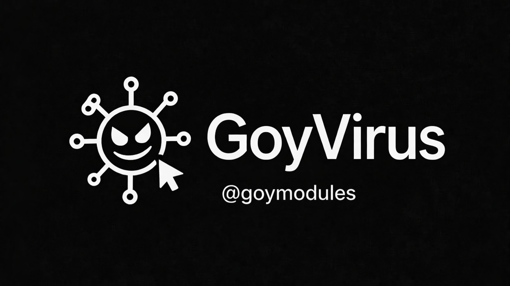

# GoyVirus — README EN

[](https://t.me/goymodules)
[](https://github.com/sepiol026-wq/GoyModules/stargazers)
[](https://github.com/sepiol026-wq/GoyModules/forks)
[](https://github.com/sepiol026-wq/GoyModules/issues)
[](https://github.com/sepiol026-wq/GoyModules/pulls)
[](https://github.com/sepiol026-wq/GoyModules/commits/main)
[](https://github.com/sepiol026-wq/GoyModules/commits/main)
[](https://github.com/sepiol026-wq/GoyModules/blob/main/LICENSE)

[Home](../README.md) · [Catalog](./readme_en.md) · [Русский](./readme_goyvirus_ru.md)

## What this module is
GoyVirus is a humorous prank module for playful chats with friends. It imitates a “virus-like” joke scenario and is not meant for harmful activity.

## ⚠️ Important warning
- Use it only for harmless entertainment in appropriate chats.
- Do not run it in work/school/sensitive contexts.
- The author **is not responsible** for misuse or resulting consequences.

## Module file
- `heroku/goyv.py` (Heroku archive)

## Installation
```text
.dlm https://raw.githubusercontent.com/sepiol026-wq/GoyModules/main/heroku/goyv.py
```

## Usage
Load the module and run prank commands in a private test chat with friends. The behavior is comedic and does not provide real malware functionality.

## Commands
- The module ships with prank-oriented commands (check in-module help after loading).

## Navigation
- [Root](../README.md)
- [Back to English index](./readme_en.md)
- [Русская версия](./readme_goyvirus_ru.md)

## License
This README and module are protected under **GNU AGPLv3**. Details: [LICENSE](../LICENSE).
