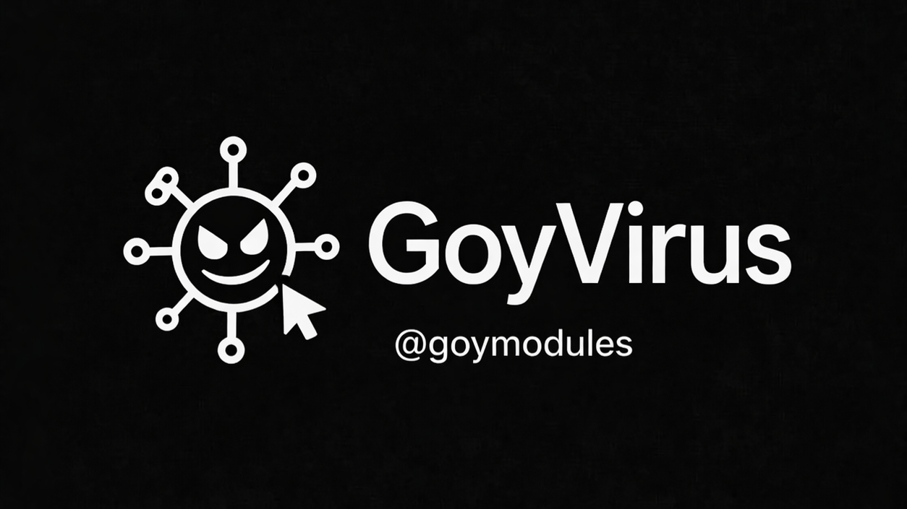

# GoyVirus — README RU

[](https://t.me/goymodules)
[](https://github.com/sepiol026-wq/GoyModules/stargazers)
[](https://github.com/sepiol026-wq/GoyModules/forks)
[](https://github.com/sepiol026-wq/GoyModules/issues)
[](https://github.com/sepiol026-wq/GoyModules/pulls)
[](https://github.com/sepiol026-wq/GoyModules/commits/main)
[](https://github.com/sepiol026-wq/GoyModules/commits/main)
[](https://github.com/sepiol026-wq/GoyModules/blob/main/LICENSE)

[Главная](../README.md) · [Каталог](./readme_ru.md) · [English](./readme_goyvirus_en.md)

## Что это за модуль
GoyVirus — шуточный тролль-модуль для розыгрышей друзей в Telegram. Он имитирует «вирусный» сценарий в формате прикола и не предназначен для вредоносной активности.

## ⚠️ Важное предупреждение
- Используйте модуль только в юмористических целях и только там, где это уместно.
- Не отправляйте в рабочие, учебные и чувствительные чаты.
- Автор **не несёт ответственности** за последствия неправильного или токсичного использования.

## Файл модуля
- `heroku/goyv.py` (архив Heroku)

## Установка
```text
.dlm https://raw.githubusercontent.com/sepiol026-wq/GoyModules/main/heroku/goyv.py
```

## Как использовать
После установки активируйте команды из модуля в тестовом чате с друзьями. Формат — «пранк-диалог», без реального заражения или доступа к данным.

## Команды
- В модуле есть собственные команды-пранки (смотрите help после загрузки).

## Навигация
- [Root](../README.md)
- [Назад в русский индекс](./readme_ru.md)
- [English version](./readme_goyvirus_en.md)

## Лицензия
Этот README и модуль защищены лицензией **GNU AGPLv3**. Подробности: [LICENSE](../LICENSE).
