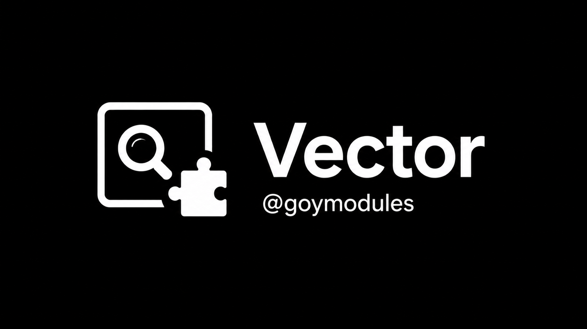

[Главная](../README.md) · [Каталог](./readme_ru.md) · [English](./readme_vector_en.md)

## Vector

Поиск модулей и коллекции Vector.

### Установка

```
.ld https://raw.githubusercontent.com/sepiol026-wq/GoyModules/main/vector.hmod
```

### Команды

`vector [query]`, `vecupdate [-f]`, `vecdl [slug/URL]`, `vecme`

Префикс `.`, если он изменён в Hotaru, замени его своим.

Каталог Vector содержит в том числе Heroku-модули. В Hotaru можно установить только настоящий `.hmod`; `.py` не преобразуется автоматически.
